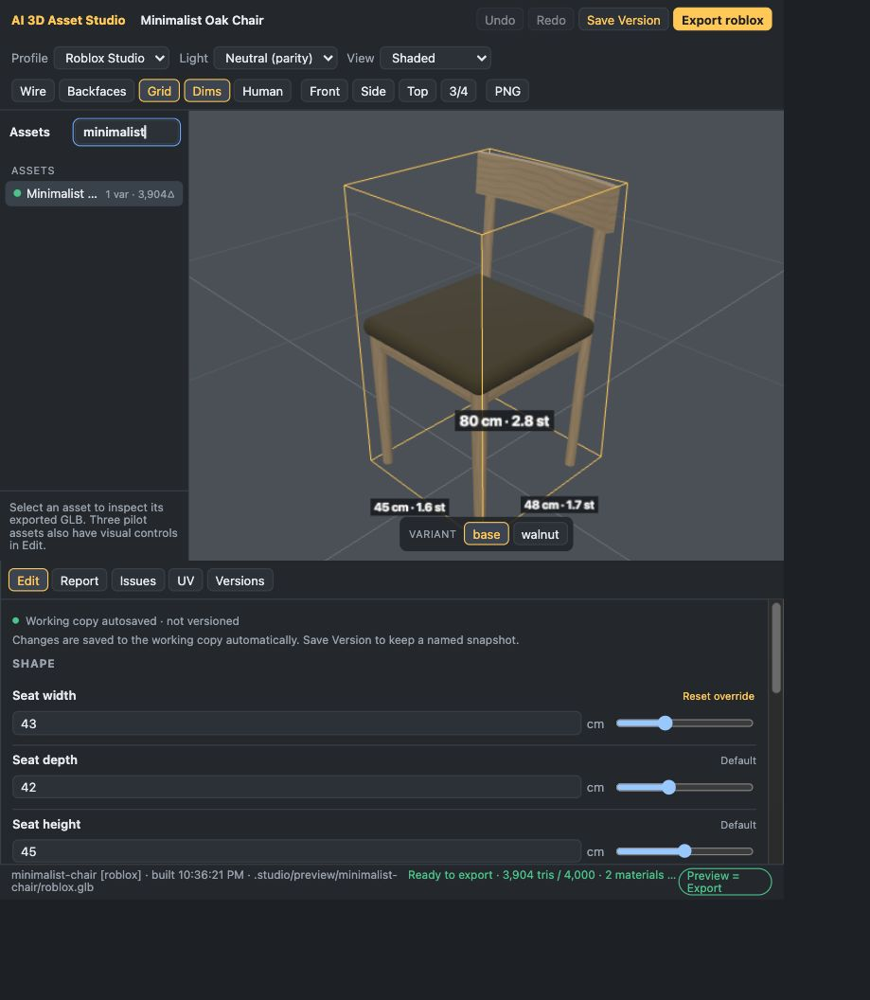

# Visual asset editor

Run `node studio dev` and open http://127.0.0.1:5178. The **Edit** tab provides
parameter and material controls for three pilot assets:

- **Minimalist Oak Chair** (`minimalist-chair`), including the `walnut` variant.
- **Wasteland Oil Drum** (`wasteland-oil-drum`), including the `fresh` variant.
- **Medieval Street Lamp** (`medieval-street-lamp`), including the `unlit` variant.

Other assets retain the existing GLB preview, Report, Issues, UV and Versions tabs.
Editing is opt-in: an asset must declare an `editor` contract before writable controls
are available. Skins and historical previews are read-only.
The [part editor](PART-EDITOR.md) adds the chest lid, mailbox flag and valve handwheel,
and new asset templates now include curated editor controls by default.



## Edit a working copy

1. Select a pilot asset and choose Base or a named variant.
2. Open **Edit**. Shape controls change authored dimensions and proportions; Surface
   controls change authored colors and material parameters.
3. Commit a number with Enter or by leaving its field. Finish a slider drag to commit
   one edit. Colors accept a picker or a six-digit hex value.
4. Wait for autosave and the build to finish. The canvas loads the new exported GLB.
5. Check the quality summary for the selected Generic, Godot or Roblox profile.

Dimensions are stored in meters. A control displaying centimeters converts its value
before saving. Seed and texture size remain controlled by the asset source in v1.
The editor never changes a browser mesh or material as a substitute for rebuilding.

For the chair, wood color regenerates the oak texture. Drum paint and rust regenerate
the procedural maps. On the lamp, glass color controls emission when glow is positive
and the opaque glass base color when glow is zero. Emissive import on Roblox remains
unverified; the existing warning is shown and does not block export.

## Autosave and versions

**Autosave** writes the current working copy after each committed edit. Reloading the
browser or restarting the server retains acknowledged changes. Autosave does not
create a version for each slider movement.

**Save Version** creates a checkpoint of the whole asset source. Enter a short note
describing the change. UI checkpoints include the base and variant Generic GLBs,
reports and thumbnails, so history previews can show the selected variant accurately.

**Undo / Redo** reverse committed parameter edits in the current browser session,
with up to 50 steps per asset and scope. They also autosave the resulting working
copy. **Restore** in Versions restores a whole asset checkpoint, including its base,
variants and editor overrides. Changes since the last checkpoint are automatically
saved before restoration; if that save fails, restoration stops.

Keyboard shortcuts:

| Shortcut | Action |
| --- | --- |
| Cmd/Ctrl+Z | Undo an editor change |
| Cmd/Ctrl+Shift+Z or Ctrl+Y | Redo |
| Cmd/Ctrl+S | Open the version-note input |

Inside text inputs, native text undo still applies. Cmd/Ctrl+S commits a valid active
parameter field and opens the version note after its preview is current. Escape
abandons an uncommitted field value. Historical previews use the Generic snapshot and are labelled as such;
return to Working copy before editing or exporting.

Older versions may have only a base GLB. The UI reports when a variant snapshot is
unavailable instead of showing the base as that variant. Restoring an older source
without editor metadata returns the asset to preview-only mode.

## Base, variants and reset

Base edits are shared with variants unless the variant has a value of its own.
Variant edits affect that named variant only. **Reset override** removes the UI edit:
an authored variant value becomes visible again, or the value is inherited from Base
when the variant source does not specify it.

For example, the chair's `walnut` variant defines its own wood and seat colors. A Base
wood-color edit does not replace the authored walnut color. Editing walnut's seat
color creates an override for walnut; resetting it restores the authored walnut seat
color.

Editing a golden asset is safe: `node studio golden` checks the authored source and ignores
`editor.json`, so trying things here never shows up as a regression.

Edits are stored in `assets/<slug>/editor.json`, alongside `asset.js`. The studio's
services write this file atomically. It is included in source hashes, history, source
diffs and engine builds. A working copy with all overrides reset has no sidecar file.

Effective parameter order is:

`source defaults → Base UI overrides → source variant → variant UI overrides → source skin → explicit runtime overrides`

## Preview status and recovery

Saving and building are separate operations. **Autosaved** means the working copy is
on disk; **Current** means the displayed GLB and report match those changes.

While a build is queued or running, the last successful model remains visible and is
marked out of date. A failed build retains the working copy and the last successful
preview. Read the error, then use Undo, Reset override or another edit to recover.
Readiness from an older report is never used to approve a newer edit.

An autosave failure retains the draft and offers Retry. A committed draft awaiting a
server acknowledgement is retained in session storage; after reload, Retry or Discard
resolves it. Invalid input is shown inline and is not written to the working copy.

If a coding agent or another editor changes the source, the server rejects the stale
edit with a conflict. **Reload source** accepts the new source; **Reapply draft** loads
the new schema and validates the draft before writing. External changes and restores
clear the affected editor undo stack. Malformed sidecars are reported explicitly and
are never silently discarded.

## Export

Choose the target profile and wait for a current preview with zero validator errors.
**Export** runs the strict exporter for the current Base or variant, writes to
`exports/<profile>/`, and returns links to the GLB, JSON report and Markdown report.
The Markdown report contains engine import instructions.

Export checks the final GLB and compares an independent rebuild with the preview
byte for byte. Source–GLB parity is recorded with the same policy as CLI export.
Warnings are shown but do not block export; validation errors do. Export is disabled
while an edit is unsaved, a preview is stale, or a build has failed. UI export does not
enable automatic decimation.

Useful CLI equivalents:

```bash
node studio save minimalist-chair -m "Wider seat and warmer oak" --include-variants
node studio diff minimalist-chair --variant walnut
node studio export minimalist-chair --variant walnut --profile roblox
```

CLI builds, review sheets, engine profiles and publishing all consume the same
persisted editor overrides. Material, geometry and skin-lock checks remain in force.

See [Stage 1 verification](EDITOR-VERIFICATION.md) for test results and the remaining
in-engine import checks.
